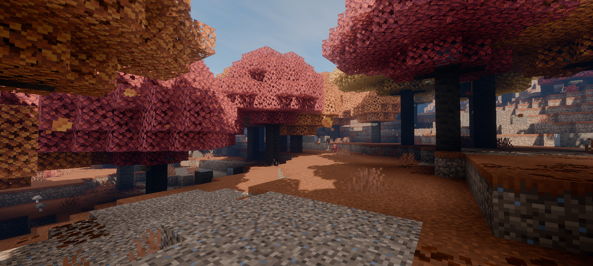

# Mirai

Mirai is a custom Vibrant Visual shader for Minecraft: Bedrock Edition. It modifies the RenderDragon rendering pipeline to give the game a more realistic look, with improved lighting, reflections, atmospheric scattering, water effects, cirrus clouds, rain puddles, and AgX tonemapping.

See more [here](https://bambosan.github.io/mirai/)

## Rendering Pipeline

At a high level, Mirai's rendering work is split into these stages. RenderDragon controls rendering pipeline.

1. **Geometry and material prepass**: Terrain, blocks, entities, and other objects write depth, normals, and material data for later shading. Objects that need it are rendered through forward-shading passes.
2. **Lighting and reflections**: Deferred passes combine the material buffers with direct lighting, filtered shadows, and indirect specular lighting. Screen-space reflections add reflections using the rendered scene.
3. **Water and atmosphere**: Water passes handle absorption, wave normals, and caustics. Atmospheric scattering, fog, sky, clouds, and volumetric effects shape the scene's atmosphere.
4. **Post-processing**: Bloom and exposure are applied before AgX tone mapping converts the scene's lighting and colors for the final image.

## Build

You need Python 3.10 or later. The build script can install the compatible Lazurite package and download the Albite compiler when they are missing. The bundled compiler setup supports Linux and Windows on x86-64 hosts.

Run a command from the repository root to compile the shader materials for a target platform:

```bash
python build.py android
python build.py windows
python build.py ios
```

To build every configured target, run:

```bash
python build.py all
```

Compiled materials are written to `output-<platform>/`, such as `output-android/`. The script compiles the materials; it does not create a `.mcpack` archive.
